# MAVLink Hub

A small, dependency-free telemetry hub for a plane that streams MAVLink over Wi-Fi
(for example an ExpressLRS Backpack). One computer runs the hub; every laptop and
phone on the same network opens a live dashboard in the browser.

- **Receive-only.** Nothing is ever sent to the aircraft.
- **One UDP client.** The hub is the only thing listening on the UDP port and fans
  the bytes out to any number of browsers over Server-Sent Events.
- **Works offline.** Map tiles are cached on disk the first time they are viewed, and
  whole areas can be downloaded ahead of a trip from the *Offline* tab.
- **Nothing to install.** Download, install, open: the download includes its own Node.js. Leaflet and
  the QR library are bundled too, so it even works without internet.

Jump to [Setting up a hub laptop](#setting-up-a-hub-laptop-windows).

<table align="center">
<tr>
<td align="center" width="50%"><a href="https://github.com/douggreenak/Mavlink-Hub/releases/latest/download/MAVLink-Hub-Setup.exe"></a><br><sub>An installer, about 37 MB. Run it; MAVLink Hub appears in your Start menu.</sub></td>
<td align="center" width="50%"><a href="https://github.com/douggreenak/Mavlink-Hub/releases/latest/download/MAVLink-Hub.dmg"></a><br><sub>A disk image, about 88 MB, Apple Silicon and Intel. Open it and drag MAVLink Hub to Applications.</sub></td>
</tr>
</table>

<p align="center"><sub><b>Nothing else to install</b>: Node.js is inside each download. Full steps are in <a href="#setting-up-a-hub-laptop-windows">Setting up a hub laptop</a>. Prefer to see how it is made? <a href="#building-the-downloads">Building the downloads</a>.</sub></p>

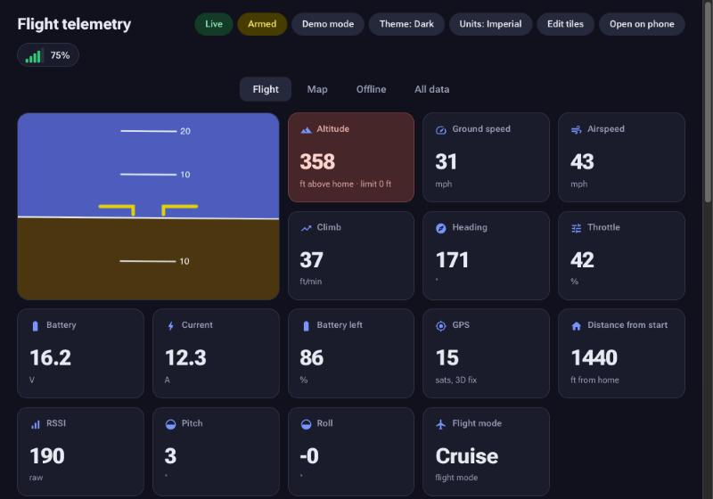

*The Flight tab, fed by the built-in test flight. The red Altitude tile means the aircraft is above the FAA drone ceiling for that spot, and the tile says what the limit is.*

## A quick look

<table>
<tr>
<td width="50%">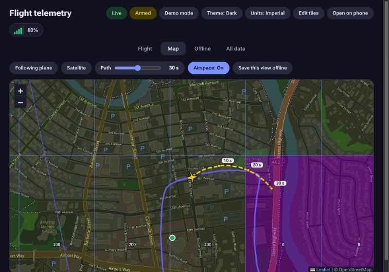<br><sub><b>Map and predicted path.</b> A smooth dashed line shows where the current turn leads, with a tick every 10 seconds.</sub></td>
<td width="50%">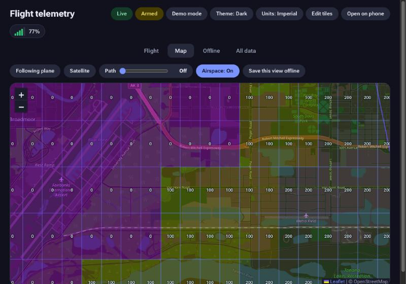<br><sub><b>Drone ceilings.</b> The FAA grid with each cell's ceiling in feet, tinted by height.</sub></td>
</tr>
<tr>
<td width="50%">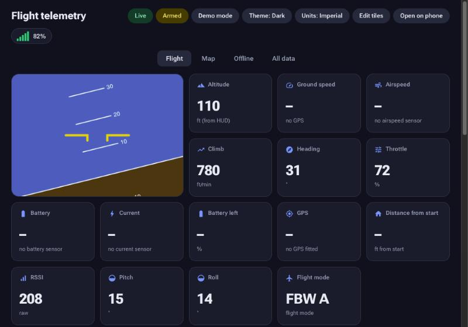<br><sub><b>Missing sensors are shown honestly.</b> No GPS, airspeed or battery sensing: dashes with the reason, not zeros.</sub></td>
<td width="50%">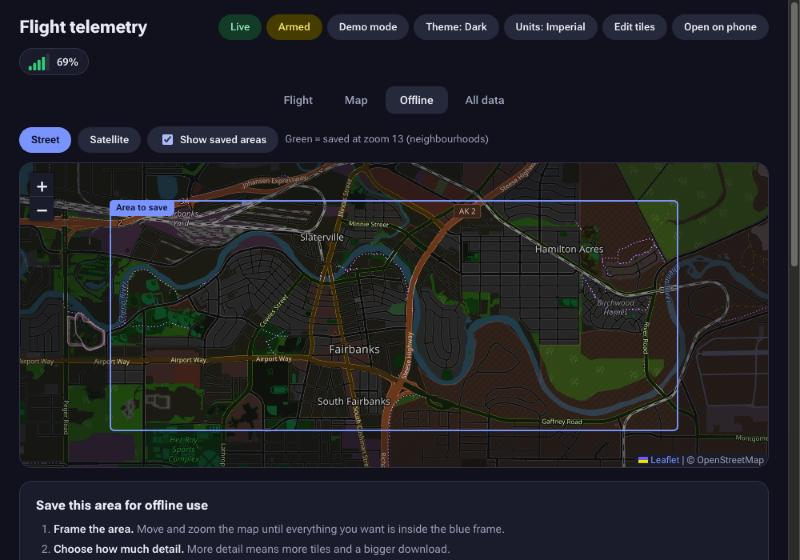<br><sub><b>Offline maps.</b> Frame an area, choose the detail, download it once.</sub></td>
</tr>
</table>

## Setting up a hub laptop (Windows)

The hub laptop is the one computer that receives the telemetry. Everyone else just opens a
web page on it. Allow about ten minutes the first time.

### 1. Download and install

Click **Download for Windows** at the top of this page (or [this link](https://github.com/douggreenak/Mavlink-Hub/releases/latest/download/MAVLink-Hub-Setup.exe))
and run **MAVLink-Hub-Setup.exe**. It installs MAVLink Hub for your Windows account (no administrator password), adds
Start menu and Desktop shortcuts and an entry in *Settings → Apps*, and offers to open it. Nothing else needs installing:
Node.js is included. If Windows SmartScreen says it protected your PC, click **More info → Run anyway** (the installer
is not code-signed; see the checksums below if you want to verify it). To remove it, use *Settings → Apps → MAVLink Hub*;
it asks whether to keep your saved maps and settings.

### 2. Start it for the first time

1. Double-click **MAVLink Hub.bat**. If Windows SmartScreen says it protected your PC,
   click **More info → Run anyway**; the file is a plain script you can open in Notepad.
2. The **MAVLink Hub** app opens straight away with a spinner while the hub starts quietly behind it (there is no black console window; closing the app stops the hub) and the
   **MAVLink Hub** window opens, showing whether the aircraft is connected, the addresses
   for phones, and the buttons you need. See [The launcher window](#the-launcher-window).
3. The first time, Windows Defender Firewall asks whether to allow **Node.js** to
   communicate on networks. Tick **Private networks** and click **Allow access**. This is
   what lets the plane's telemetry in and lets phones reach the dashboard. If you dismissed
   it, open *Windows Security → Firewall & network protection → Allow an app through
   firewall* and tick Node.js for Private networks.
4. Make sure the Wi-Fi network you fly on is marked **Private** in Windows (*Settings →
   Network & internet → Wi-Fi → the network's properties → Private network*). On a
   *Public* network Windows blocks incoming connections even for allowed apps, and phones
   will not be able to open the dashboard.
5. Optional: double-click **Create desktop shortcut.bat** to put a MAVLink Hub icon on your
   Desktop, so you never need to open the folder again.

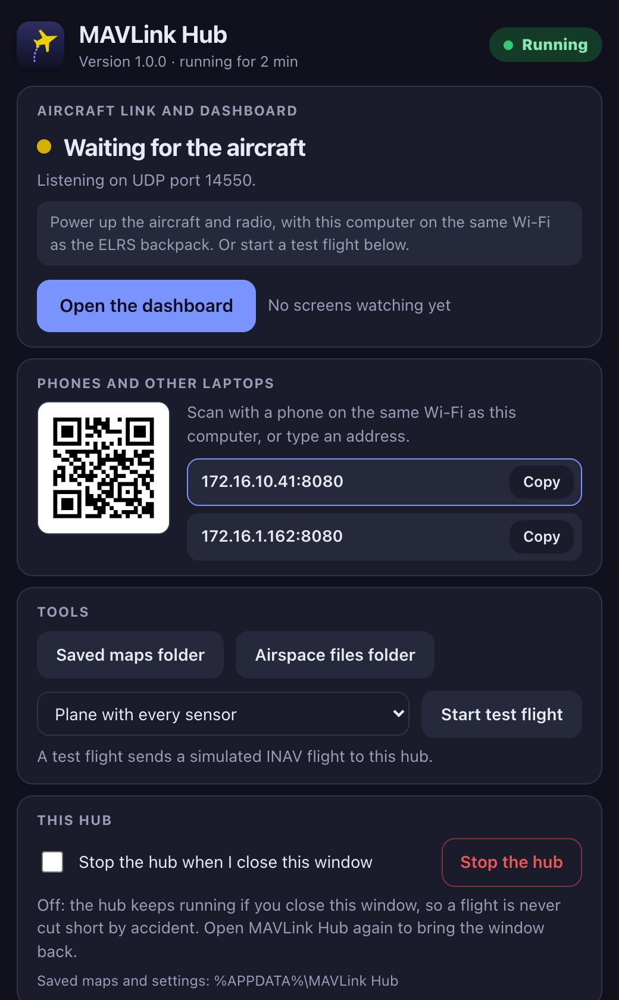

*The launcher window just after starting, before the aircraft is on.*

### On a Mac

Same idea, with a Mac app instead of the batch file.

1. Click **Download for Mac** at the top of this page (or [this link](https://github.com/douggreenak/Mavlink-Hub/releases/latest/download/MAVLink-Hub.dmg)),
   open **MAVLink-Hub.dmg** and drag **MAVLink Hub** onto the **Applications** folder beside it. It works on both Apple
   Silicon and Intel Macs, and everything, including Node.js, is inside the one app. (Run it from the disk image or Downloads
   instead and it offers to move itself to Applications.)
2. Double-click **MAVLink Hub.app**. The first time, macOS may refuse because it was downloaded: right-click the
   app and choose **Open**, then **Open** again. If it still refuses, open *System Settings → Privacy & Security*
   and click **Open Anyway**.
3. When macOS asks whether to let **node** accept incoming network connections, click **Allow**.
   That is what lets the aircraft's telemetry and your phones reach the hub.

Saved maps, airspace data and settings are kept in `~/Library/Application Support/MAVLink Hub`, never inside the app,
so replacing the app with a newer one loses nothing.

The Mac app is the only difference; everything below applies to both.

### 3. Connect the plane's telemetry

The hub listens for MAVLink on UDP port 14550 and nothing else needs configuring on the
laptop. What matters is that the telemetry source and the laptop are on the same network.

**ExpressLRS TX Backpack** (the usual case; see the
[ExpressLRS MAVLink guide](https://www.expresslrs.org/software/mavlink/) for the full
picture). You need an ESP-based TX module with a backpack, ELRS 3.5 or newer and backpack
firmware 1.5 or newer.

1. In the ELRS Lua script on the radio, set the link mode to **MAVLink**.
2. Still in the Lua script, go to **Backpack → Telemetry** and set it to **WiFi**. The
   backpack then starts Wi-Fi and forwards MAVLink on its own. Do not use *Enable Backpack
   WiFi*; that is the firmware-update mode and sends nothing.
3. Put the laptop on the same Wi-Fi as the backpack. Two ways:
   - **The backpack's own network**, named `ExpressLRS TX Backpack XXXXXX`, password
     `expresslrs`. Simple, needs no other hardware, but has no internet and only room for a
     few devices.
   - **A shared network**: set the backpack's *Home WiFi* name and password (in the ELRS
     Configurator when flashing, or the backpack's web page) to a phone hotspot or a small
     travel router, and put the laptop and the phones on that too. This is the better
     setup when several people want the dashboard, and it keeps internet for map tiles.
4. Power up the plane and radio. Within a few seconds the dashboard's chip changes from
   *Hub connected, no telemetry* to **Live**.

**Anything else that sends MAVLink over UDP** (a SiK radio through MAVProxy, a companion
computer, a simulator) works too: point it at the laptop's IP address, port 14550. The
laptop's address is shown in the hub window.

Only one program can receive the UDP stream on a given port. If Mission Planner or
QGroundControl is also running on the hub laptop and listening on 14550, they will fight
over the packets; close them there, or give the hub a different `UDP_PORT` (see Settings).

### 4. Open the dashboard on phones and other laptops

1. Put the phone on the same Wi-Fi as the hub laptop.
2. On the hub's dashboard click **Open on phone** and scan the QR code, or type the
   address from the hub window (something like `http://192.168.1.23:8080`) into the
   phone's browser.
3. Add it to the phone's home screen for a full-screen view. Any number of screens can
   watch at once; units and hidden tiles are shared across all of them.

### 5. Before a flying trip

- **Save the maps while you still have internet.** Open the *Offline* tab, frame the flying
  area, pick a detail level, and download. Tiles you merely look at on the *Map* tab are
  kept too. Saved maps and airspace data live in `%APPDATA%\MAVLink Hub`, outside the program folder, and
  survive reboots and updates.
- **Stop the laptop from sleeping** while plugged in (*Settings → System → Power & battery
  → Screen and sleep*). A sleeping laptop drops the telemetry and the phones lose the page.
- Consider a **hub.env** file (copy `hub.env.example`) if you want a different port or map
  settings. Nothing is needed for a plain setup.

### Updating

The MAVLink Hub window has an **Updates** card. It checks GitHub for a newer release when the window opens (and whenever you press
**Check for updates**); if there is one it shows what changed and a **Download and install** button. The hub downloads the
release for your computer, checks it against the release's published SHA-256 checksum, closes itself, swaps in the new version
and reopens, in about a minute. Saved maps, airspace data and settings are kept in the saved-data folder (see *Where saved maps
and airspace live*), and `hub.env` is never overwritten, so nothing is lost. Do not update during a flight: the hub stops while it
installs.

It can only update the installed app. A copy run from a Git checkout is told about the new version and given a link; there,
`git pull`. On a Mac the app must be somewhere it can write to (Applications). Set `UPDATE_CHECK=off` in `hub.env` to turn the
checking off. The only thing sent is the request to GitHub's public releases API.

### Troubleshooting

| What you see | What it means | What to do |
| --- | --- | --- |
| Dashboard says **Hub offline** | The browser cannot reach the hub | Start MAVLink Hub.bat; on a phone, check it is on the same Wi-Fi and the network is marked Private on the laptop |
| **Hub connected, no telemetry** | The hub runs but no MAVLink arrives | Check the backpack is in MAVLink mode with Telemetry = WiFi, that the laptop is on the backpack's network, and that Node.js is allowed through the firewall |
| The launcher says **the hub could not start**, or its window shows **Stopped** | Usually another program already holds port 8080 or 14550, or Node.js is missing | Read the message; close the other program, or change `WEB_PORT` / `UDP_PORT` in `hub.env`; **Show log** in the launcher has details |
| Map is blank in the field | No internet and that area was not saved | Download it from the *Offline* tab next time you are online |
| Values look wrong or jumpy | Usually a weak link | Click the signal bars at the top right for link statistics; *All data* shows every raw message |

The hub's own messages are in `%APPDATA%\MAVLink Hub\hub.log`.

## The launcher window

Opening MAVLink Hub starts the hub if it is not already running, then shows its control
window. Open it again at any time: it finds the running hub and just shows the window, so you never start two.

<table>
<tr>
<td width="50%">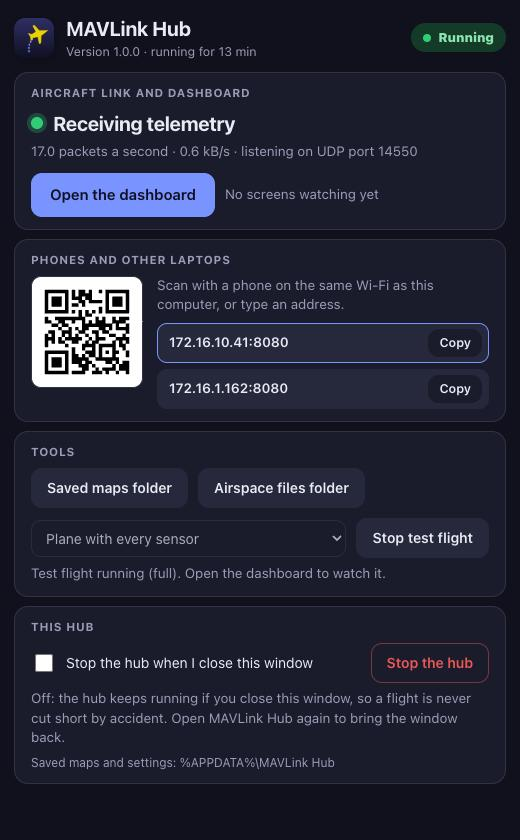<br><sub>Receiving telemetry, in dark mode.</sub></td>
<td width="50%">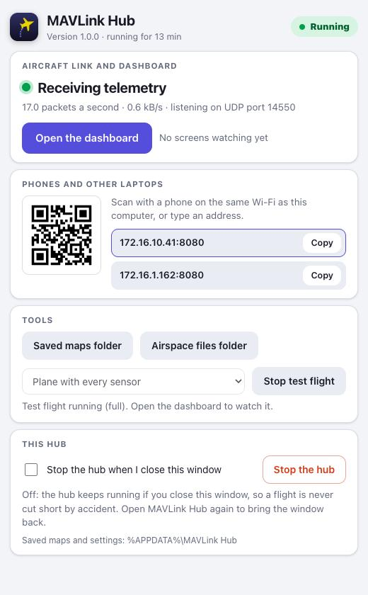<br><sub>The same in light mode. It follows your computer's setting.</sub></td>
</tr>
</table>

- **Aircraft link.** Whether the radio is sending: "Waiting for the aircraft", "Receiving telemetry" with packets and
  kilobytes a second, or "Telemetry stopped" if the link drops, with a plain hint about what to check.
- **Open the dashboard** opens it in your normal browser, and shows how many screens are watching.
- **Phones and other laptops.** A QR code and the addresses to type, each with a Copy button. Click an address to
  make the QR code point at it (useful when the laptop has both Wi-Fi and Ethernet).
- **Tools.** Open the saved-maps folder or the folder for your own airspace files, show the hub's log, and start a
  **test flight**: a simulated INAV flight (with or without GPS, airspeed or battery sensing, and so on) sent to
  this hub, so you can try everything with no aircraft.
- **This hub.** **Stop the hub** quits it. Closing the window (or quitting the app) also stops the hub, so nothing is
  left running in the background; open MAVLink Hub again to start it. Take care not to close it during a flight.


*After pressing Stop. Open MAVLink Hub again to start it.*

**How it works.** The window is a web page served by the hub itself (`launcher.html`). In the downloads it is shown in the
app's own window: a native window on the Mac (its own Dock icon, name and menu; closing it or quitting the app stops the hub),
and **MAVLink Hub.exe** on Windows, a real app with its own icon and taskbar button (it shows the page in a WebView2 control, the Edge engine that comes with Windows 10 and 11; closing it stops the hub). Right-click its taskbar button and choose *Pin to taskbar* to keep it there.
If that is not possible it falls back to an app-style Edge, Chrome, Brave or Chromium window (with its own small profile, so
your normal browser is untouched), or your default browser. A short script, `launcher.js`, does the starting;
`MAVLink Hub.bat` (with `launcher.ps1`) and `MAVLink Hub.app` just check that Node.js is available, run it, show the window,
and show a plain dialog if something is wrong. On Linux, run `node launcher.js`.

**It is only for the hub computer.** The control page can stop the hub and open folders, so the hub refuses it from
phones and other laptops, from any host name other than `localhost`, and from other web pages (every action needs a
header a web page cannot send to another site). Other screens only ever see the dashboard.

**If it will not start,** a dialog says why, most often that Node.js is not installed or that another program already
holds port 8080 (close it, or set `WEB_PORT` in `hub.env`). The hub's own messages are in `hub.log` in the saved-maps
folder, and the **Show log** button displays them.

## Running it elsewhere

- **Windows without the window**: `start.bat` runs the hub in a plain console.
- **Mac from a Git checkout**: `start.command` does the same in a Terminal window.
- **Linux, or any computer**: `node launcher.js` for the window, or `node server.js` for just the hub.
- **From a Git checkout** (no bundled Node): install [Node.js](https://nodejs.org) 18 or newer, then run one of the commands
  above. The launchers use the bundled copy in `runtime/` when there is one and fall back to the Node on your computer.

Then open <http://localhost:8080>.

### Settings

All optional. Put them in a `hub.env` file in the saved-data folder (below), or next to `server.js` in a Git checkout (copy `hub.env.example`), or
set them as environment variables, which take precedence.

| Variable | Default | Meaning |
| --- | --- | --- |
| `UDP_PORT` | `14550` | Port the MAVLink source sends to |
| `WEB_PORT` | `8080` | Port for the dashboard |
| `MAX_TILES` | `500` | Largest bulk map download allowed, in tiles. `0` removes the limit |
| `DATA_DIR` | per-user app folder | Where saved maps (`cache/`) and `settings.json` are kept |
| `TILE_STREET_URL` | OpenStreetMap | Street tile template, e.g. `https://example.com/{z}/{x}/{y}.png` |
| `TILE_SAT_URL` | Esri World Imagery | Satellite tile template; note Esri's order is `{z}/{y}/{x}` |
| `UPDATE_CHECK` | on | `off` stops the hub checking GitHub for new versions |
| `TILE_TERRAIN_URL` | AWS Terrain Tiles (Terrarium) | Elevation tile template for the 3D Vision tab |

Public tile servers ask for modest use, which is why bulk downloads are limited and
paced. Point the two URL variables at your own tile source to lift that.

### Where saved maps and airspace live

Tiles are ordinary files, so they survive restarts and reboots. By default they are kept in
the per-user application folder, outside this checkout, so deleting or re-cloning the
project does not lose them:

| | |
| --- | --- |
| Mac | `~/Library/Application Support/MAVLink Hub/cache/` |
| Windows | `%APPDATA%\MAVLink Hub\cache\` |
| Linux | `~/.local/share/mavlink-hub/cache/` |

Airspace data (`airspace/`), `settings.json`, `hub.log` and your `hub.env` sit in the same folder one level up. Nothing is
ever written inside the app, and updating means replacing only the app.

The Offline tab shows the exact path. Set `DATA_DIR` to put them on a bigger disk. Older
versions kept `cache/` next to `server.js`; the hub moves that into place the first time it
starts, so nothing is lost on upgrade.

### Downloading larger areas

The 500-tile cap exists because the default sources are shared, free servers, and it
keeps the hub's footprint small. It does not make bulk downloads allowed there:
OpenStreetMap's [tile usage policy](https://operations.osmfoundation.org/policies/tiles/)
prohibits any pre-fetching for offline use (only tiles a person is actively viewing, which
the Map tab caches as you go), and Esri says its standard World Imagery layer is not
intended for export. Violations are blocked without notice. The cap is a setting, not a
rule of the hub:

```bash
MAX_TILES=0 node server.js
```

lifts it entirely, and any other number sets a new cap. The hub still pauses briefly
between tiles so a big download trickles rather than floods. If you plan to save whole
regions, point `TILE_STREET_URL` and `TILE_SAT_URL` at a tile server you are allowed to
bulk-download from (your own, or a paid provider) and then lift the limit.

## Dashboard

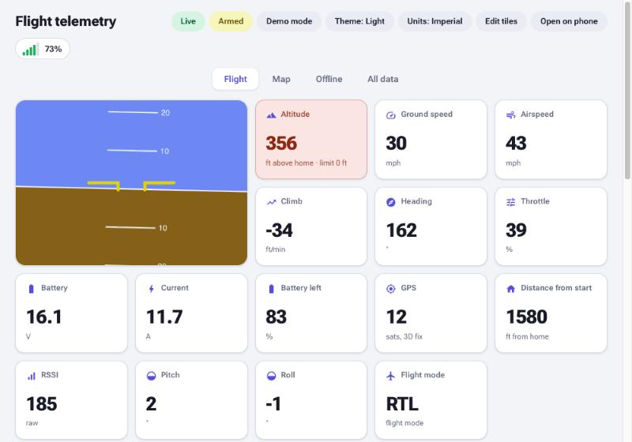

*Light mode. The theme follows your device unless you pick one.*

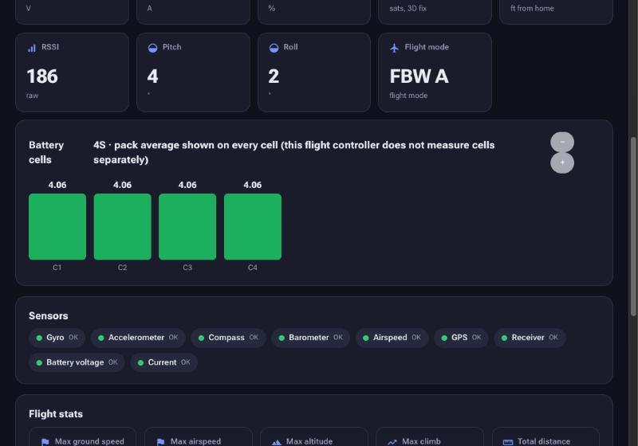

*Further down the Flight tab: battery cells, the Sensors card, and flight statistics.*

- **Flight**: attitude indicator, speed/altitude/battery tiles, per-cell voltages,
  flight statistics, RC channels. *Edit tiles* hides what you do not need; the choice
  is stored on the hub so every screen matches.
- **Map**: live track with a follow mode and a street/satellite toggle, a predicted path, and airspace layers with ceiling numbers (below).
- **3D Vision**: a Garmin-style synthetic vision view (3D aircraft, terrain, flight-path ribbon and a flight-display
  overlay) with chase, cockpit and orbit cameras. The terrain is real elevation data from the free
  [AWS Terrain Tiles](https://registry.opendata.aws/terrain-tiles/) (USGS 3DEP, about 10 m, in the US including
  Alaska; SRTM and other public data elsewhere). The hub downloads each tile once and keeps it with the map tiles, so it
  works without internet afterwards. To have an area ready before a trip with no internet, open *Offline*, choose
  *Terrain (3D)*, frame the area and download. Without terrain data the ground is drawn flat.
- **Offline**: frame an area on the map, pick Overview, Standard or Detailed (each shows its
  size before you commit), and download it. Saved areas show in green. To free space, delete
  the tiles inside the frame at the chosen detail, or everything saved for a layer.
- **All data**: every decoded MAVLink message and field, with rates.
- **Demo mode** simulates a flight so you can try the dashboard without a plane.

<table>
<tr>
<td width="50%">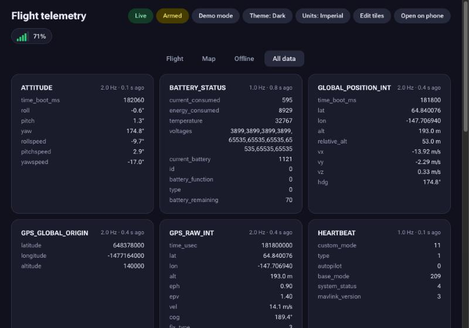<br><sub><b>All data.</b> Every decoded message, its rate, and every field.</sub></td>
<td width="50%">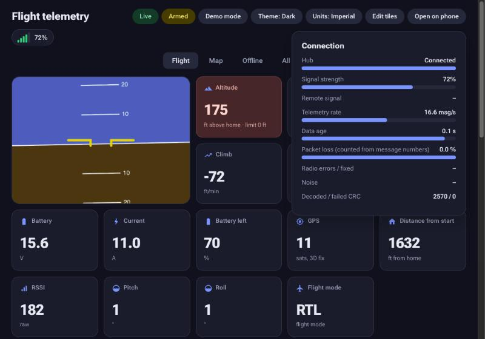<br><sub><b>Connection.</b> Click the signal bars: signal, rate, data age, and packet loss counted from message numbers.</sub></td>
</tr>
</table>

### On a phone

The same page works on a phone, with the tabs along the bottom.

<table>
<tr>
<td width="50%">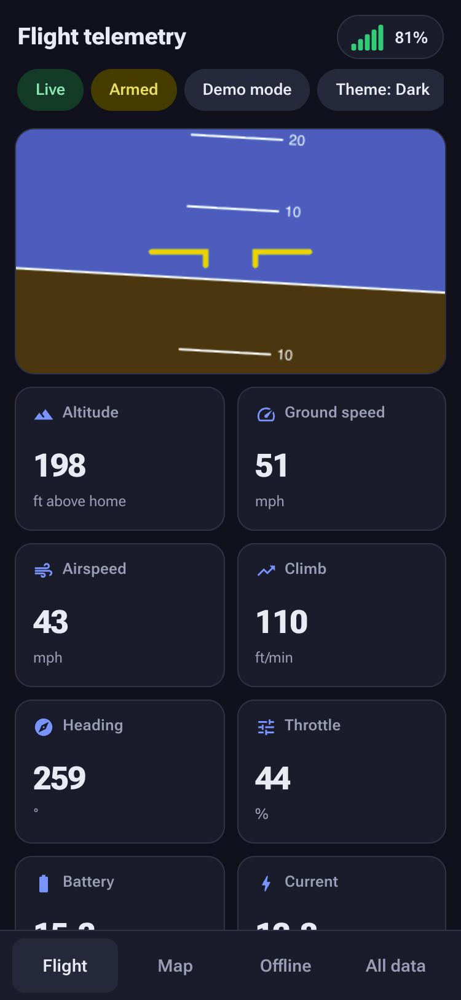</td>
<td width="50%">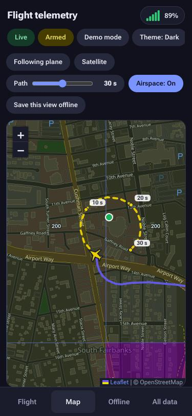</td>
</tr>
</table>

Decoded messages: HEARTBEAT, SYS_STATUS, SYSTEM_TIME, GPS_RAW_INT, SCALED_PRESSURE,
ATTITUDE, GLOBAL_POSITION_INT, RC_CHANNELS, VFR_HUD, RADIO_STATUS, BATTERY_STATUS and
STATUSTEXT, in MAVLink v1 or v2 (signed frames included). Anything else is counted
under *Unrecognised messages*. To add a message, append a row to the `D` table near the
top of the script in `index.html` with its id, name, `CRC_EXTRA` and fields in wire order.

### Saving a map area

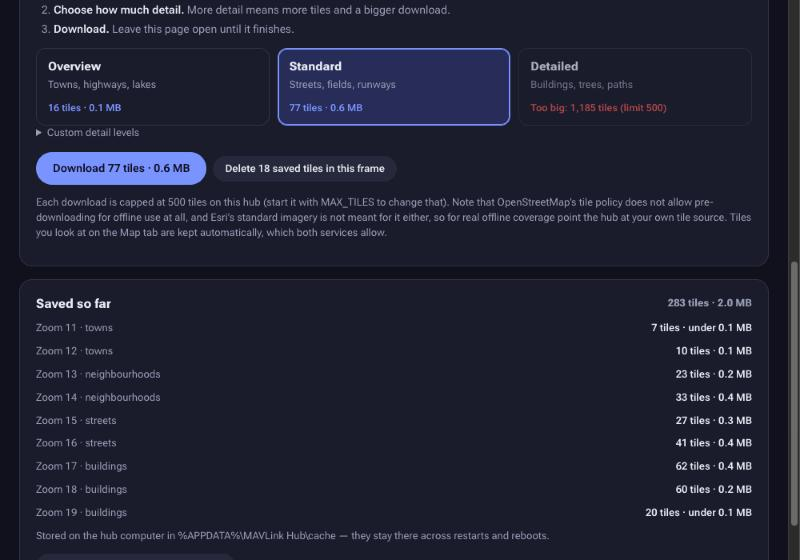

*Each choice shows its size before you commit. What is saved is listed below, and you can delete an area or a whole layer.*

## Predicted path


*Path length is set with the slider next to the Map controls.*

The Map tab draws a dashed line ahead of the aircraft showing where it ends up if it holds its current turn,
with a tick every 10 seconds. The **Path** slider sets how far ahead it looks, from off to 60 seconds in 5-second steps; your setting is remembered. It starts under the icon,
follows the direction of travel (not where the nose points, so wind is allowed for), and stops after one full circle.

The turn rate comes from how the direction of travel is changing and, on fixed wings, from the bank angle as well.
INAV's own yaw-rate field is not used, because INAV fills it with gyro degrees per second although MAVLink says
radians per second. The line is hidden when there is no GPS fix or the data is stale, so it never invents a path.

Honest limits: a constant-turn prediction helps most over the next few seconds and in orbits. Measured against the test
flight, the drawn path was about 20% closer to where the aircraft really went than a plain line along its last reported
course at 3 s, and about 12% closer at 5 s. Beyond roughly 10 s it is no better than a straight line, because pilots roll
out of turns. Treat the longer lengths as "where this turn leads", not a forecast.

The direction of the path is turned at the measured turn rate between position reports and corrected gently when each
report arrives, so it neither lags in a tight turn nor jumps at every report.

Motion is smooth because the icon is dead-reckoned from each position report and corrections are faded in over
a fraction of a second. INAV's default is only two reports a second over the radio, which is why other tools look jerky.

## Airspace

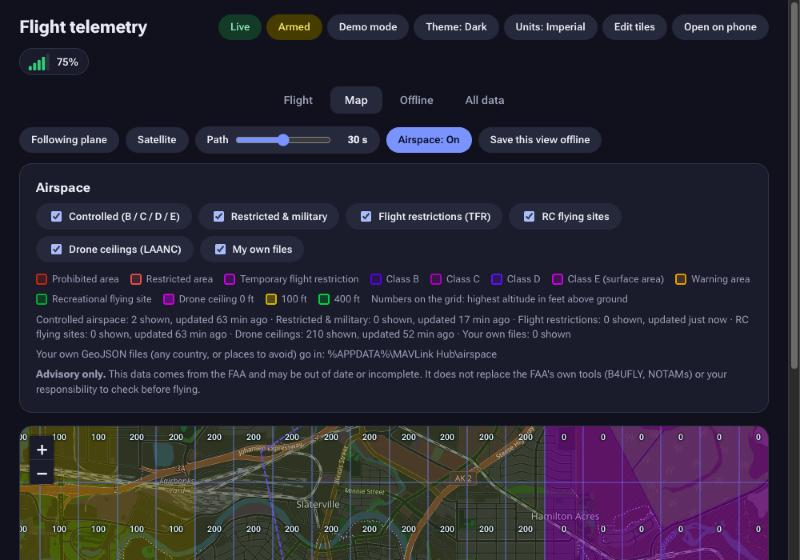

*The Airspace panel: choose layers, see the legend, and see how fresh each layer is.*

Switch **Airspace** on in the Map tab. The hub fetches public FAA data for the area in view, saves it on disk
(so it keeps working offline once you have looked at an area) and the dashboard draws it:

| Layer | What it is |
| --- | --- |
| Controlled | Class B, C, D and surface-area Class E |
| Restricted & military | Prohibited, restricted, warning, alert and military operations areas, national-defense and national-security UAS restrictions |
| Flight restrictions | Current temporary flight restrictions (TFRs), refreshed every 10 minutes |
| RC flying sites | FAA-recognised recreational flying sites |
| Drone ceilings | The FAA drone ceiling grid (LAANC), only when zoomed in |
| My own files | Your own GeoJSON files (below) |

A small ring spins inside the **Airspace** button and in the map's top-right corner while map tiles or airspace data are still loading, and if the data can't be loaded the button turns amber and says why, in the Airspace panel and on the map. Everything the hub fetches is saved on disk in the `airspace` folder, separately for each area and each FAA service, so an area is downloaded once and then reused (and survives restarts). It is refreshed after two weeks, TFRs every 10 minutes, and if the FAA is unreachable the saved copy is used and marked as such.

Click any shape for its name, floor and ceiling. The drone-ceiling grid shows each cell's ceiling in feet as a number once you are zoomed in far enough to read it, and the **Altitude** tile on the main page turns red when the aircraft is above the ceiling for where it is. Only airspace starting at ground level up to 400 ft is considered (change with `AIRSPACE_MAX_FLOOR_FT`); Class A is never shown.

**This is advisory only.** The data can be out of date or incomplete, TFR altitudes and times are in the NOTAM, and
the FAA's own tools (B4UFLY, NOTAMs) and your own checks are what count. Coverage is the United States. For other
countries, or for places you want to avoid (a neighbour, a school), put GeoJSON files in the `airspace` folder inside
the saved-maps folder (the Airspace panel shows the exact path). Polygons work, and a point with a `radius_m` property becomes
a circle. Optional properties: `name`, `kind` (`restricted`, `prohibited`, `warning`, `class-d`...; anything else is
drawn as "your own area"), `floor`, `ceiling` (feet) and `note`. `AIRSPACE=off` stops the hub fetching anything.

## INAV over ELRS

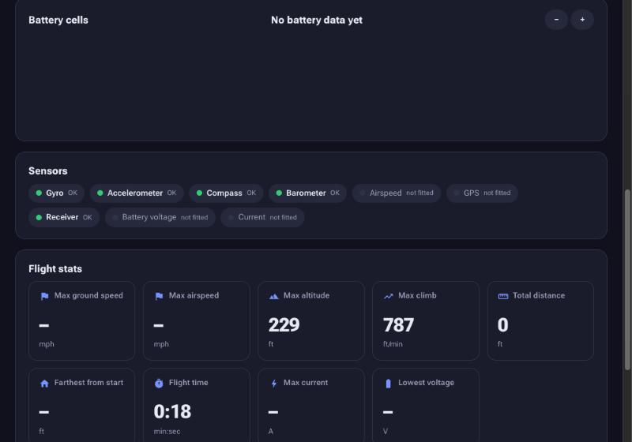

*A bare-bones plane: the Sensors card shows what is fitted, and nothing pretends to be measured when it is not.*

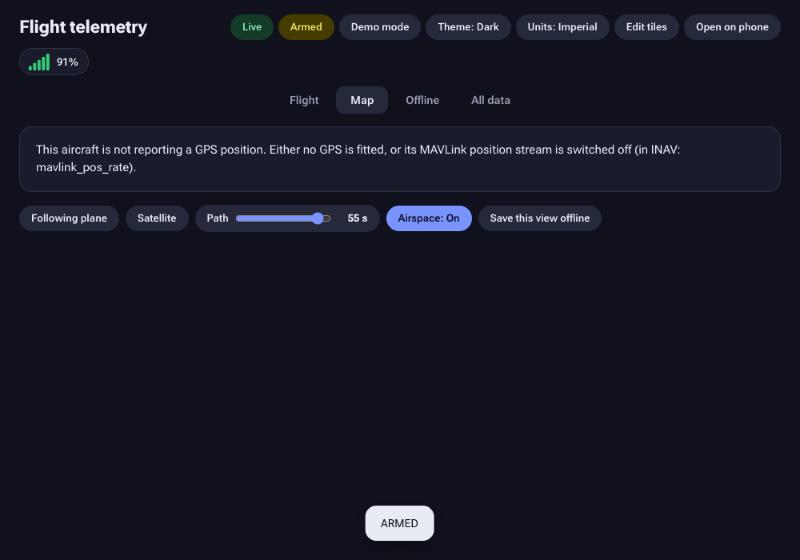

*With no GPS the map says so and says what to check, rather than waiting forever.*

The dashboard is built around what INAV actually sends, taken from INAV's own MAVLink source:

- **Missing sensors are shown as missing.** INAV sends no position messages without a GPS, reports 0 V, -1 A and
  100% remaining with no battery sensing, and 0 airspeed with no pitot. The tiles show "no GPS", "no battery sensor",
  "no airspeed sensor" and so on, those zeros never reach the statistics, and a **Sensors** card shows what is fitted
  and healthy. Altitude falls back to the HUD message when there is no GPS.
- **GPS without a fix** is shown as waiting, not as a track starting at 0,0. A lost fix keeps the last position and says so.
- **Flight modes** are INAV's ArduPilot-style mode numbers, shown as names (FBW A, Cruise, RTL, Loiter...).
- **Home** comes from INAV's `GPS_GLOBAL_ORIGIN` message when it has set one.
- **Packet loss** is counted from message sequence numbers, because INAV's own drop-rate field is always 0.
- **MAVLink 1 and 2**, signed frames, and frames split across radio packets are all handled.
- INAV repeats the pack average on every cell, so per-cell bars say that rather than pretending to be measured.
- Extra senders on the link (a ground-station heartbeat, a radio status source) do not replace the aircraft.

INAV sends attitude, position and airspeed only twice a second by default (and RC and battery once a second), to
spare the radio. The dashboard is smooth at that rate, but you can raise it in the INAV CLI, for example
`set mavlink_extra1_rate = 5` (attitude), `set mavlink_pos_rate = 5` (position) and `save`, if your link has the room.
If a bare-bones plane shows no position, check `mavlink_pos_rate` is not 0.

## Test flights without an aircraft

```bash
npm run sim                              # a plane with every sensor, INAV's default message rates
node sim/inav-sim.js --profile minimal   # no GPS, airspeed or battery sensing
node sim/inav-sim.js --list              # every profile
```

On Windows, double-click **Test flight.bat**. The simulator sends INAV-style MAVLink to the hub on UDP 14550, so
start the hub first and open the dashboard. Profiles can be combined, for example `--profile minimal,split`:
`nogps`, `nofix` (GPS that takes 25 s to lock), `nopitot`, `novbat`, `noamp`, `nomag`, `v1` (MAVLink 1), `fast`,
`lossy` (10% of frames lost), `corrupt`, `split` (frames cut across packets), `dropout` (link silent for 4 s every
30 s), `radio` (an ELRS-style radio status plus a ground-station heartbeat), `copter` and `ardupilot`. The flight is a
racetrack with wind, so the course differs from the heading and the turns are real. Use `--host` and `--port`
to point it at another machine.

## Building the downloads

The two downloads, the Windows installer and the Mac disk image, are built by one script and are not stored in the repository (they are large):

```bash
node tools/build-packages.js            # both, with the current Node LTS, into dist/
node tools/build-packages.js --only mac # one of them
node tools/build-packages.js --node v24.22.2
node tools/build-packages.js --zips     # also a portable ZIP of each, for trying a build locally
```

It copies the app and the right launchers for each system, adds Node.js straight from nodejs.org, and refuses to
use a download whose SHA-256 does not match nodejs.org's published list. The official Node binaries are used
untouched, so their signatures stay valid (the Mac package holds one for Apple Silicon and one for Intel; the
launcher picks the right one). `dist/SHA256SUMS.txt` lists the checksum of each download, and the in-app updater checks against it. Needs `unzip` and `tar`.

The Windows installer is built with [NSIS](https://nsis.sourceforge.io) (`brew install makensis`) and the Mac disk image with `hdiutil`,
so a full build runs on a Mac; elsewhere `--no-installers` makes just the app folders (with `--zips`, as ZIPs). To publish a version, push a tag; a GitHub Action
builds the installer and disk image and attaches them (and the checksums) to a release, which is what the download buttons point at:

```bash
git tag v1.0.0
git push origin v1.0.0
```

Windows and Mac cannot be signed without paid developer certificates, so each shows a one-time warning on first run;
the steps above explain how to approve it.

## Tests

```bash
npm test
```

Uses Node's built-in test runner, so there is still nothing to install. The suite
covers the tile math and request validation, the HTTP/UDP/SSE server end to end
against a local fake tile source (no internet needed), the browser-side MAVLink decoder
(loaded from `index.html` into a stubbed DOM with a virtual clock), and the following,
all offline:

- every message the dashboard decodes is checked field by field against definitions
  extracted from the official MAVLink XML, using an encoder that shares no code with the decoder;
- the simulator is run through the dashboard for every missing-sensor and link-fault profile, and through a real
  UDP socket, the hub and the live stream, checking the bytes arrive unchanged and are understood;
- smoothness and prediction are measured frame by frame at 60 fps, including against a straight-line baseline;
- the launcher's control API is tested for who may use it (only this computer, only the hub's own host name, only with
  the right header, so another web page cannot press Stop), for every button's action, and for the stop-when-closed
  switch; `launcher.js` is run for real to check it starts a hidden hub, reuses a running one, and explains a busy port;
- the download packages are assembled and run on their own (a packaged copy starts a working hub), the Mac app is
  started with no Node on the system to prove it uses the bundled one, and every launcher is checked to look where the
  build puts it;
- the airspace service is tested against a fake FAA server using trimmed real FAA responses in `test/fixtures`
  (caching, offline use, FAA outages, paging, your own files), plus the inside / will-enter logic.
